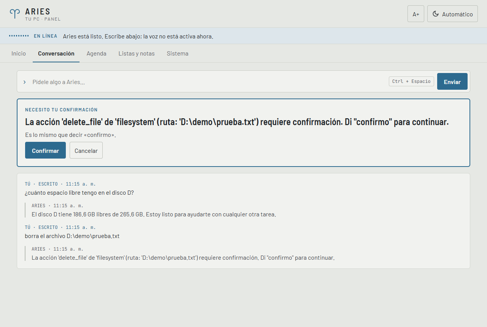
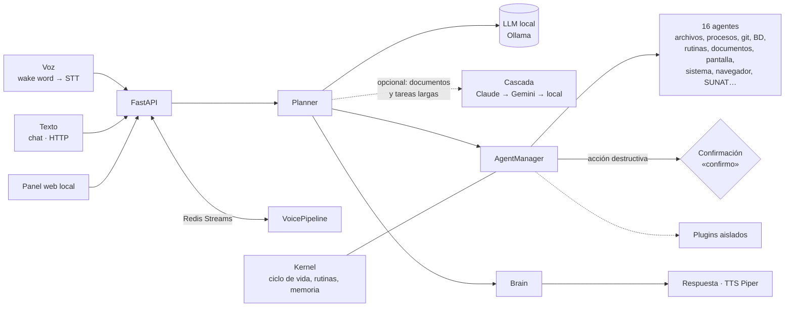
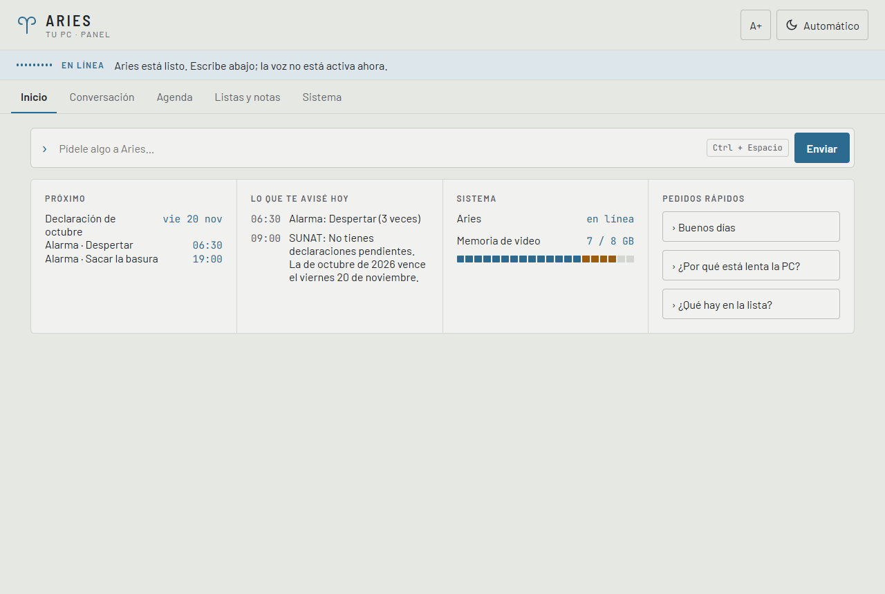
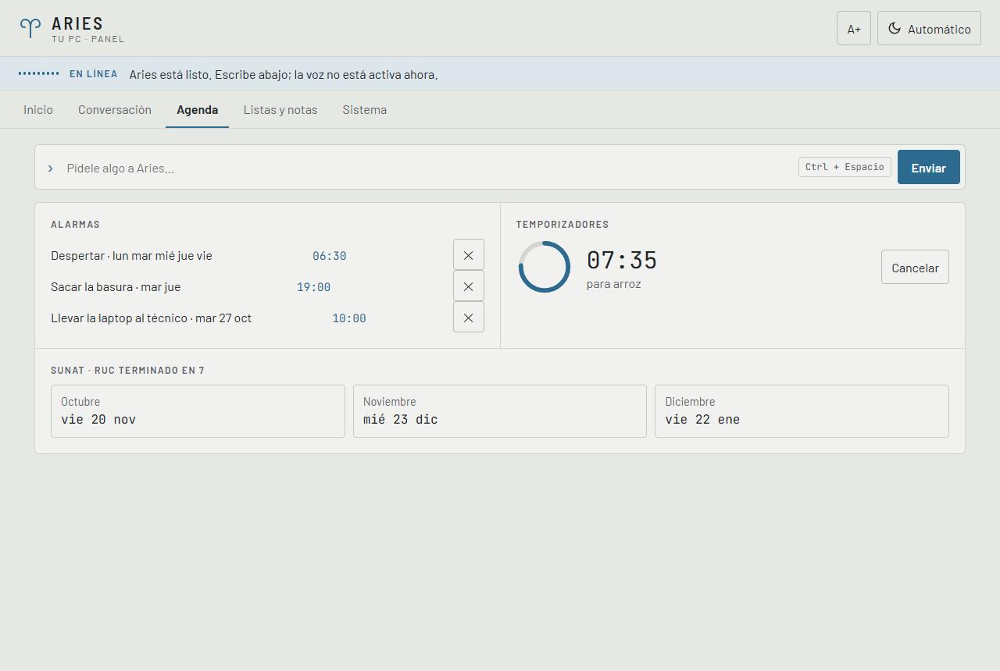
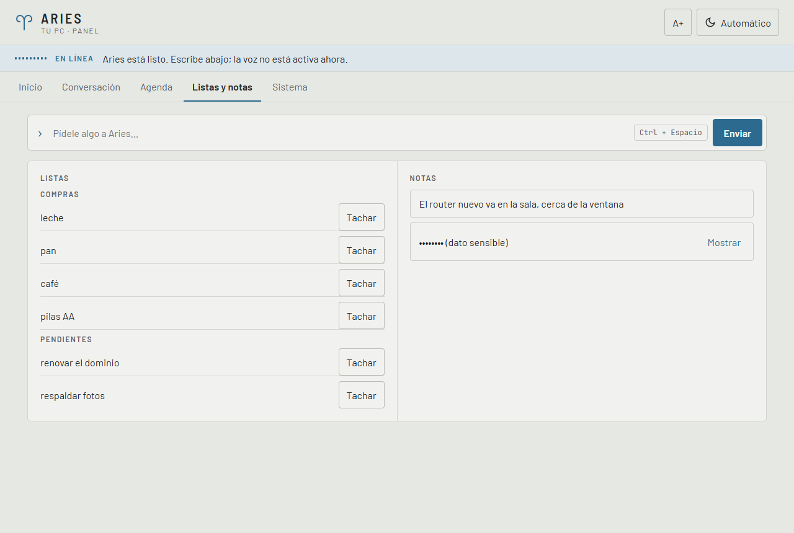
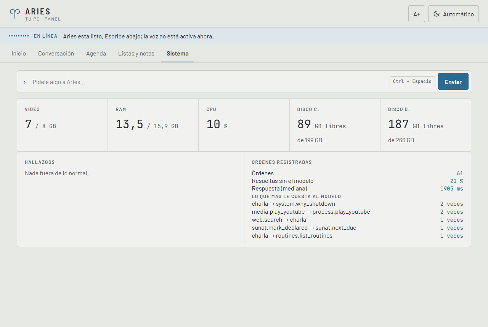

# Aries OS

Asistente personal por voz y texto que ejecuta acciones reales en la PC (archivos, procesos, git, bases de datos, recordatorios, Word, YouTube, navegador) a partir de lenguaje natural, con modelos de lenguaje locales vía Ollama. Ninguna acción irreversible se ejecuta sin una confirmación explícita, y cada paso queda registrado.

    

> 🔒 **Código privado.** Este repositorio muestra el proyecto; el código está disponible a pedido en oropeza.dev@gmail.com.

## Lo más destacado

- **Texto o voz → plan → acción.** Un Planner pide al modelo un plan de pasos, el `AgentManager` despacha cada paso a uno de **16 agentes** (archivos, procesos, git, bases de datos, rutinas, documentos, pantalla, sistema, Office, medios, listas, notas, búsqueda web, navegador, tareas y SUNAT) y el Brain redacta la respuesta.
- **Confirmación obligatoria.** Borrar, matar un proceso o escribir en una base queda pendiente hasta que se confirma con la frase exacta, por texto o por voz. Correr un comando o un script la pide siempre, sin excepciones por contenido.
- **Voz manos libres y local:** palabra de activación (openWakeWord), transcripción (faster-whisper) y síntesis (Piper), sin servicios en la nube.
- **Dos modelos locales:** uno chico (qwen2.5:3b, entero en la GPU) entiende la orden y uno más grande (qwen2.5:7b) redacta la charla, que se habla por partes mientras se genera.
- **Tareas de varios pasos** con un bucle que mira, actúa y vuelve a mirar, incluido un navegador propio (Playwright sobre Edge), con reglas fijas contra instrucciones escondidas en páginas y contra la fuga de datos. Guarda cómo resolvió cada tarea para reusarlo como ejemplo.
- **Cascada opcional a la nube** (apagada por defecto): solo para redactar documentos y para el bucle de tareas, Claude → Gemini → modelo local, con salto automático si un proveedor no tiene saldo o llegó a su límite. La conversación reciente y los datos personales nunca salen de la PC.
- **Rutinas y recordatorios** con cron real, reintentos y caducidad (no dispara avisos vencidos hace horas); temporizadores, alarmas que insisten, listas, notas y el calendario de declaraciones mensuales de la SUNAT según el último dígito del RUC.
- **Plugins aislados:** un plugin roto no tumba el Kernel ni a los demás.

## Arquitectura

Cada agente cumple el contrato `IAgent` y declara qué acciones exigen confirmación (`requires_confirmation()`). La voz corre en un proceso aparte que se comunica con la API por Redis Streams, con entrega al menos una vez y acuse después de actuar.

## Cifras

Medidas sobre el código y el CI de la rama principal (25 de octubre de 2026):

| | |
|---|---|
| Pruebas en CI (Windows) | **1146 aprobadas**, 110 omitidas (casi todas de voz, que en CI corre sin el extra `voice`, y las que necesitan Redis) |
| Pruebas en CI (Linux, con Postgres 16 y Redis 7 reales) | **1024 aprobadas**, 9 omitidas, **75 % de cobertura** |
| Lint, formato y tipos (ruff, black, mypy) | sin errores en 241 archivos |
| Seguridad en CI | bandit y pip-audit en verde |
| Código | ~19 500 líneas de Python en 180 módulos, más ~17 200 de pruebas |
| Evaluación de intención | conjunto fijo de 102 frases de uso diario y 5 seguimientos, corrido contra el modelo real para medir regresiones al sumar agentes o cambiar de modelo |
| Historial | 248 commits desde julio de 2026 |

## Capturas

Panel web local (`/panel`) de la instalación real. La conversación es real; la agenda, las listas, las notas y la SUNAT llevan datos de ejemplo.

**Inicio**: lo próximo, lo que Aries avisó hoy y el estado del sistema.

**Agenda**: alarmas, temporizador en curso y vencimientos de la SUNAT calculados por el propio calendario de Aries.

**Listas y notas**: las notas con datos sensibles se ocultan hasta pedirlas.

**Sistema**: uso de la PC y métricas de las órdenes registradas, incluidas las correcciones más frecuentes al modelo.

## Stack

- **Núcleo:** Python 3.13, FastAPI, Pydantic / pydantic-settings, SQLAlchemy, structlog.
- **Modelos:** Ollama (qwen2.5:3b y qwen2.5:7b); opcionales Claude y Gemini por API.
- **Mensajería:** Redis Streams entre la API y la voz; bus de eventos tipado dentro del proceso.
- **Voz:** openWakeWord, faster-whisper, Piper.
- **Automatización:** Playwright sobre Edge, croniter para las rutinas.
- **Calidad:** pytest, ruff, black, mypy; GitHub Actions en Linux y Windows con bandit y pip-audit.

## Contacto

📬 oropeza.dev@gmail.com · [LinkedIn](https://www.linkedin.com/in/jhonatan-oropeza) · [Perfil de GitHub](https://github.com/oropezadev-wq)
